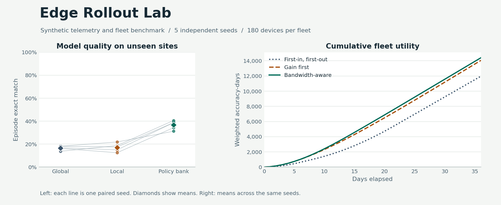

# Edge Rollout Lab

An offline ML systems project that trains incident classifiers for edge gateways and schedules their releases across a bandwidth-constrained fleet. The benchmark separates model development, rollout planning, and evaluation on unseen sites.



## Run locally

The benchmark was tested with Python 3.10. It generates its own telemetry and fleet. After installing dependencies, the experiment runs offline.

```bash
python -m venv .venv
.venv/bin/python -m pip install -r requirements.txt
.venv/bin/python -m edge_rollout --output reports
.venv/bin/python -m unittest discover -s tests -v
```

On Windows, use `.venv\Scripts\python.exe` in the last three commands.

The default benchmark runs five fixed seeds. Use `--seeds 17 --devices 60 --days 24` for a smaller experiment. The output folder contains `benchmark.json` with per-seed values, `schedule.csv` with the first seed's bandwidth-aware plan, and `benchmark.png`.

## How it works

1. **Generate telemetry.** Each site follows one of four incident policies covering latency, resource saturation, network reliability, and service errors. An episode contains ten labeled support events and six query events. Training, validation, and test draw 40, 16, and 20 distinct synthetic sites per seed. Each site contributes eight episodes. Validation and test include more simulated bursts and shifts in the feature distributions.
2. **Compare classifiers.** The global model is a pooled logistic regression. The local model fits a logistic regression to an episode's support events. The policy bank trains four logistic regressions with policy IDs available in the simulated training set. At inference, the support labels determine a posterior over policies. The bank scores all 64 possible label vectors for the six query events and selects the most probable vector. Scaling runs inside each scikit-learn pipeline.
3. **Build a release plan.** Validation accuracy in thousandths sets the estimated quality of each release. The simulator releases the three model versions on different days with different package sizes. Each device has an update quota and a priority. The planner respects release days, per-site and fleet-wide daily bandwidth limits, and one update per device per day.
4. **Replay the schedule.** An independent validator checks every deployment. For evaluation it assigns release quality from the held-out test sites. Daily utility is the sum of each device's priority multiplied by installed model accuracy. The benchmark sums this value over the horizon, including installation day.

The scheduler compares arrival-ordered FIFO, marginal-gain insertion, and a bandwidth-aware search. The marginal gain of an insertion counts only the days before the next scheduled replacement. The bandwidth-aware strategy tries gain divided by package size to the powers 0, 0.5, and 1, then retains the plan with the highest validation-based utility.

## Benchmark results

Means across five independent seeds with 180 devices, five sites, and a 36-day horizon per fleet. Classification metrics cover 800 held-out episodes in total. Episode exact match requires all six query labels to be correct.

| Model | Query accuracy | Episode exact match |
| --- | ---: | ---: |
| Global logistic regression | 72.77% | 16.6% |
| Local logistic regression | 73.65% | 17.1% |
| Policy bank | **82.83%** | **36.8%** |

| Rollout strategy | Weighted accuracy-days | Transferred MB |
| --- | ---: | ---: |
| FIFO | 11,976.2 | 2,427.0 |
| Gain first | 14,061.2 | 3,300.6 |
| Bandwidth-aware | **14,406.0** | 2,747.4 |

Bandwidth-aware planning raised mean utility by **20.3% over FIFO** and **2.5% over gain first**. It delivered a model to all 180 devices in each run and used **16.8% fewer MB than gain first**. The raw JSON records utility in weighted milli-accuracy-days. The table and figure divide that value by 1,000.

The simulator assumes deterministic transfers, a fixed event rate, and recurring policy families. The measured gains describe this synthetic benchmark. The planners use heuristics. A test compares them with exhaustive search on one small fleet.

## Repository layout

| Path | Purpose |
| --- | --- |
| `edge_rollout/learning.py` | Telemetry generator, fitting, and held-out model metrics |
| `edge_rollout/scheduler.py` | Rollout policies and independent chronological validator |
| `edge_rollout/experiment.py` | Paired benchmarks with release planning and held-out replay |
| `edge_rollout/plot.py` | Reproducible Matplotlib figure |
| `tests/` | Schedule constraints, a tiny exact oracle, and split-isolation check |
| `reports/` | Example results and sample schedule from the default benchmark |

## References

- Modeling uses scikit-learn's preprocessing and logistic regression pipelines. [scikit-learn documentation](https://scikit-learn.org/stable/)
- The benchmark chart is generated with Matplotlib. [Matplotlib documentation](https://matplotlib.org/stable/)
- Workflow guidance for grouped evaluation and figure design followed Kassis, Agarwal, He, Patel, and Brueckner (2026), *Scientific Agent Skills*. [Paper](https://doi.org/10.48550/arXiv.2609.00065)
